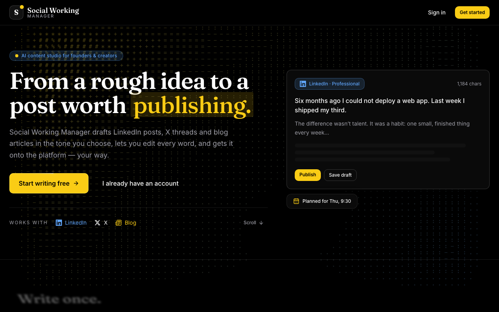
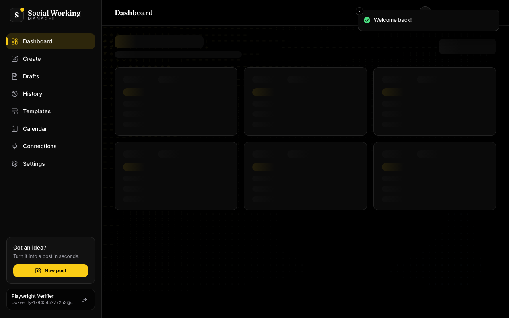
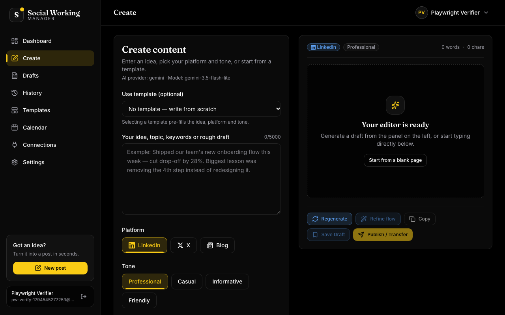
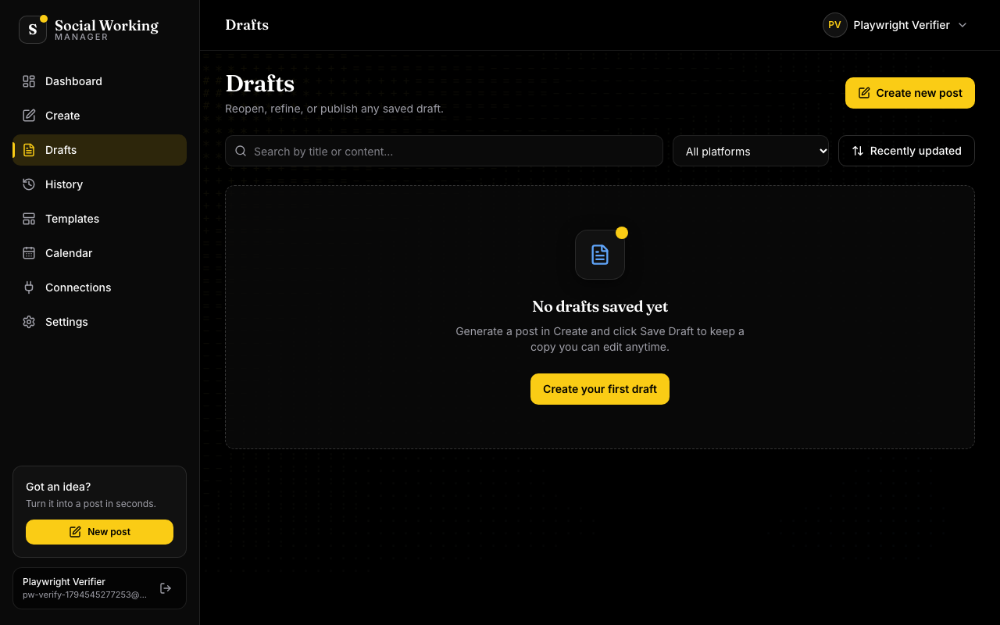
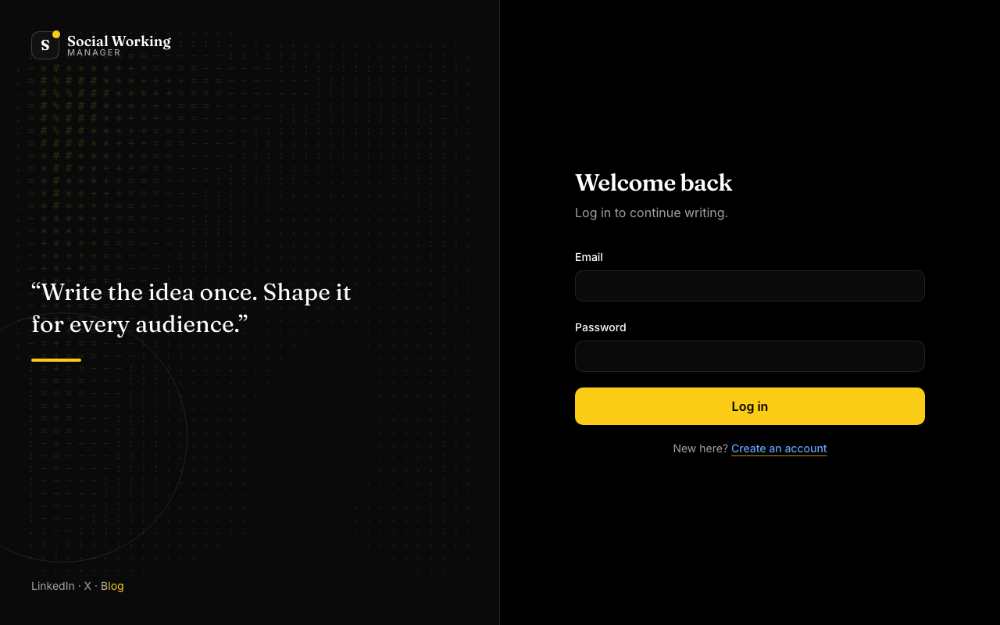

# Social Working Manager

**AI-powered multi-platform content studio for founders, engineers, and creators.**  
Turn a rough idea into publication-ready **LinkedIn posts**, **X (Twitter) threads**, and **Markdown blog articles** with live streaming generation, platform-specific tone & formatting, reusable `{placeholder}` templates, a monthly planning calendar, and one-click publishing.

<p align="center">
  
</p>

---

## Workflow Impact & Time Reduction

Social Working Manager eliminates context switching between notes apps, chatbots, thread splitters, and social composers. Below are **estimated creator workflow benchmarks** comparing manual multi-platform writing against using Social Working Manager:

| Workflow Task | Manual Process | With Social Working Manager | Time Saved |
| :--- | :---: | :---: | :---: |
| Turn rough bullet points into a polished LinkedIn post | ~25 min | **~1.5 min** | **94% faster** |
| Split, number & enforce 280-char limits on an X thread | ~12 min | **< 5 sec** *(auto-enforced)* | **99% faster** |
| Adapt 1 core idea across LinkedIn + X + Blog Markdown | ~50 min | **~4 min** | **92% faster** |
| Weekly batch (5 cross-platform posts + planning) | ~5.5 hrs/week | **~25 min/week** | **~5 hrs/week saved** |

> *Overall estimated drafting-to-publish overhead is reduced by **~90%**, cutting per-post turnaround from ~45 minutes to under 4 minutes. (Figures above are illustrative workflow estimates combining live SSE streaming, starter templates, and automated formatting.)*

---

## Visual Walkthrough & Screen Guide

### 1. Landing Page & Interactive Hero (`/` — Desktop & Mobile)
A high-contrast black canvas (`#000000`) layered over a capped-FPS, yellow-to-blue animated ASCII gradient field (`AsciiGradientBg`), scroll-linked text reveal (`CylinderReveal`), value highlight section (`BlurValueParagraph`), and step-by-step workflow breakdown. Respects `prefers-reduced-motion` and falls back to an instant plain UI when `NEXT_PUBLIC_BASIC_UI=true`.


---

### 2. Command Center Dashboard (`/dashboard`)
Provides immediate quick-launch cards that pre-select the target platform (`/create?platform=LINKEDIN|X_TWITTER|BLOG`), live account counters (`Total Generated`, `Saved Drafts`, `Published / Transferred`, `Templates`), a "Continue your drafts" shortcut strip, platform bar chart visualization via Recharts, and recent activity logs.



---

### 3. Real-Time AI Streaming Editor (`/create`)
Streams generated drafts token-by-token over Server-Sent Events (`/api/generate/stream`) directly into the live editor. Supports template selection with `{placeholder}` pre-fill, 4 selectable tones (`Professional`, `Casual`, `Informative`, `Friendly`), Markdown preview/edit toggle, **Refine flow** second-pass polishing (`/api/refine`), automatic server-side X 280-character thread numbering/splitting, draft saving, and publishing.



---

### 4. Drafts Library & Version Control (`/drafts`)
Search, filter by platform, sort, reopen any draft inside the full Markdown editor (`/drafts/[id]`), compare raw vs. refined AI passes inside **History** (`/history`), or publish directly from a card.



---

### 5. Split-Pane Authentication (`/login`, `/register`)
Clean asymmetric authentication flow backed by Supabase Auth, featuring form validation with `react-hook-form` + `zod` and seamless redirect support back into protected workspace routes.



---

### 6. Responsive Mobile Experience (`390px` Viewport)
Every route adapts cleanly to narrow viewports with a sticky 5-slot mobile bottom bar (`Dashboard`, `Create`, `Drafts`, `Calendar`, `More`) and a slide-over left navigation drawer exposing all 8 workspace sections.

| Mobile Hero | Mobile Dashboard | Mobile Create Studio | Slide-Over Nav Drawer |
| :---: | :---: | :---: | :---: |
|  |  |  |  |

---

## Tech Stack

| Layer | Technologies |
| :--- | :--- |
| **Framework & Language** | [Next.js 14](https://nextjs.org/) (App Router), React 18, TypeScript 5 |
| **Styling & Design Tokens** | [Tailwind CSS 3.4](https://tailwindcss.com/) with RGB CSS variable tokens (`--rgb-*` for alpha transparency), custom WCAG AA high-contrast palette |
| **UI Primitives & Charts** | [Radix UI](https://www.radix-ui.com/) (`Dialog`, `AlertDialog`, `DropdownMenu`, `Select`, `Tabs`), `lucide-react`, `sonner` toasts, `recharts`, `react-markdown` |
| **Animations & Canvas** | Custom HTML5 Canvas ASCII gradient renderer (`requestAnimationFrame` capped at 20 FPS), `IntersectionObserver` scroll reveals, `motion` |
| **Database & Auth** | [Supabase](https://supabase.com/) (`@supabase/ssr`, `@supabase/supabase-js`) — PostgreSQL, Email Auth, Row Level Security (RLS), Postgres signup trigger |
| **AI Generation (Pluggable)** | Google Gemini REST streaming (`streamGenerateContent?alt=sse`), OpenAI API, Anthropic Messages API (`LLM_PROVIDER` switch) |
| **Publishing & Security** | LinkedIn OAuth 2.0, X (Twitter) OAuth 2.0 + PKCE with automatic refresh-token rotation, AES-256-GCM encrypted token columns, **One-Click Transfer** fallback |
| **Forms, Validation & Testing** | `react-hook-form`, `zod`, `@hookform/resolvers`, Playwright, custom WCAG contrast & RLS isolation verification scripts |

---

## Key Capabilities

- **Streaming Generation + Safe DB Persistence**: Text streams live to the browser and persists generation metadata (`contentId`, `version`) without blocking token delivery if a DB write warns.
- **Zero-Credential Demoable Publishing**: Even if LinkedIn or X OAuth credentials are omitted, clicking **Publish / Transfer** copies content to the clipboard, opens the composer (or downloads `.md` for Blog articles), and provides step-by-step publish guidance.
- **X Thread Safeguards**: Pre-checks 280-character boundaries per post, auto-splits long copy into numbered posts (`1/N`, `2/N`), handles partial thread posting failures transparently, and supports `X_MOCK=true` locally.
- **Row-Level Security & Encrypted Secrets**: OAuth tokens are encrypted server-side with AES-256-GCM (`TOKEN_ENCRYPTION_KEY`) and protected from anon/authenticated column exposure via PostgreSQL column grants (`supabase/migrations/002_protect_tokens.sql`).
- **Accessibility & Contrast Verified**: All 19 UI foreground/background token combinations meet **WCAG AA (>= 4.5:1)** via `npm run check:contrast`.

---

## Project Structure

```text
├── app/
│   ├── (marketing)/        # Public landing page (/)
│   ├── (auth)/             # Split-screen /login & /register flows
│   ├── (app)/              # Protected workspace (/dashboard, /create, /drafts, /history, /templates, /calendar, /connections, /settings)
│   └── api/                # Route handlers (/generate, /generate/stream, /refine, /publish, /connections/*, CRUD endpoints)
├── components/
│   ├── create/             # Streaming editor, platform/tone chips, live Markdown preview
│   ├── connections/        # OAuth status cards & Publish / One-Click Transfer dialog
│   ├── dashboard/          # Stats, quick actions, Recharts platform visualization
│   ├── landing/            # ASCII gradient canvas, CylinderReveal, BlurValueParagraph, ScrollProgress
│   ├── layout/             # AppShell sidebar + mobile drawer, NavProgress, Logo
│   └── ui/                 # Theme-tokenized shared Radix/Tailwind primitives
├── lib/                    # LLM streaming/providers, X limits, AES-256-GCM crypto, OAuth helpers, Supabase clients
├── supabase/               # Full schema setup (setup_all.sql) & incremental migrations
├── scripts/                # Setup checks, contrast checker, X mock suite, RLS tests, LLM benchmarks
└── docs/                   # Architecture report, X setup guide, verification screenshots
```

---

## Getting Started

### 1. Prerequisites
- **Node.js** 18.18+ (20+ / 22+ recommended) and **npm**
- A **[Supabase](https://supabase.com)** project (PostgreSQL + Auth)
- An API key for at least one LLM provider: **Google Gemini** *(default)*, **OpenAI**, or **Anthropic**

### 2. Configure Supabase
1. Create a project at [database.new](https://database.new).
2. Open **SQL Editor -> New query** in Supabase, paste [`supabase/setup_all.sql`](./supabase/setup_all.sql), and run it.  
   *(Creates enums, tables, RLS policies, column-level token protection, and the signup trigger seeding starter templates.)*
3. In **Authentication -> Providers -> Email**, toggle **Confirm email** off for instant local testing.
4. In **Authentication -> URL Configuration**, add `http://localhost:3000/auth/callback` to **Redirect URLs**.
5. Grab your Project URL, `anon` public key, and `service_role` key from **Project Settings -> API**.

### 3. Environment Setup (Secrets stay local in `.env.local`)
Copy `.env.example` to `.env.local` (`.env.local` is strictly gitignored and never pushed to GitHub):

```bash
cp .env.example .env.local
```

Generate a 32-byte encryption key for `TOKEN_ENCRYPTION_KEY`:

```bash
openssl rand -base64 32
```

Fill in `.env.local`:

```env
NEXT_PUBLIC_SUPABASE_URL=your_supabase_url
NEXT_PUBLIC_SUPABASE_ANON_KEY=your_anon_key
SUPABASE_SERVICE_ROLE_KEY=your_service_role_key

LLM_PROVIDER=gemini                 # gemini | openai | anthropic
GEMINI_API_KEY=your_gemini_api_key

TOKEN_ENCRYPTION_KEY=your_base64_32byte_key
NEXT_PUBLIC_APP_URL=http://localhost:3000
NEXT_PUBLIC_BASIC_UI=false
```

<details>
<summary>Optional Environment Variables & OAuth Configuration</summary>

| Variable | Default | Purpose |
|---|---|---|
| `LLM_MODEL` | provider default | Override model name (e.g. `gemini-2.5-flash`) |
| `LLM_MAX_OUTPUT_TOKENS` | `8192` | Max tokens per generation response |
| `LLM_TWO_PASS` | `false` | Set `true` to run an automatic second LLM refinement pass |
| `LLM_REFINE_ENABLED` | `true` | Enable `/api/refine` and the **Refine flow** editor button |
| `NEXT_PUBLIC_BASIC_UI` | `false` | Set `true` to render the plain, un-animated fallback UI |
| `LINKEDIN_CLIENT_ID` / `SECRET` | unset | Optional LinkedIn OAuth direct publishing ([callback]: `/api/connections/linkedin/callback`) |
| `X_CLIENT_ID` / `SECRET` | unset | Optional X OAuth 2.0 PKCE direct publishing ([docs/X_SETUP.md](./docs/X_SETUP.md)) |
| `X_MOCK` | `false` | Dev-only mock mode (`@mock_user`) for testing X OAuth & posting without API credits |

</details>

### 4. Install & Run Locally

```bash
npm install
npm run check:setup   # Optional: verify env, Supabase schema & LLM connectivity
npm run dev
```

Open [http://localhost:3000](http://localhost:3000).

---

## Available Scripts

| Command | Description |
| :--- | :--- |
| `npm run dev` | Start Next.js development server (`localhost:3000`) |
| `npm run build` | Build production bundle |
| `npm run typecheck` | Run TypeScript type checking (`tsc --noEmit`) |
| `npm run lint` | Run ESLint |
| `npm run check:contrast` | Validate WCAG AA contrast ratios across all theme token pairs |
| `npm run test:x` | Run unit & mock integration tests for X formatting, refresh rotation & error handling |
| `npm run test:rls` | Verify Supabase RLS tenant isolation |
| `npm run check:setup` | Diagnose environment variables, DB tables, triggers & live LLM reachability |
| `npm run bench:llm` | Benchmark latency across LLM model variants |

---

## Deploying to Vercel

1. Import this repository into [Vercel](https://vercel.com/new).
2. Add all required keys from `.env.example` in **Project Settings -> Environment Variables**, setting `NEXT_PUBLIC_APP_URL` to your deployed URL.
3. Add `https://your-app.vercel.app/auth/callback` (plus OAuth callbacks if enabled) in Supabase **Authentication -> URL Configuration**.
4. Deploy.
