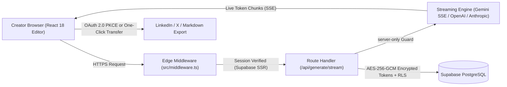
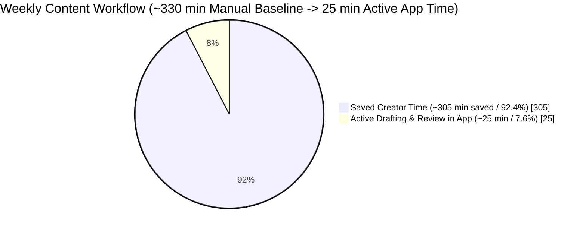
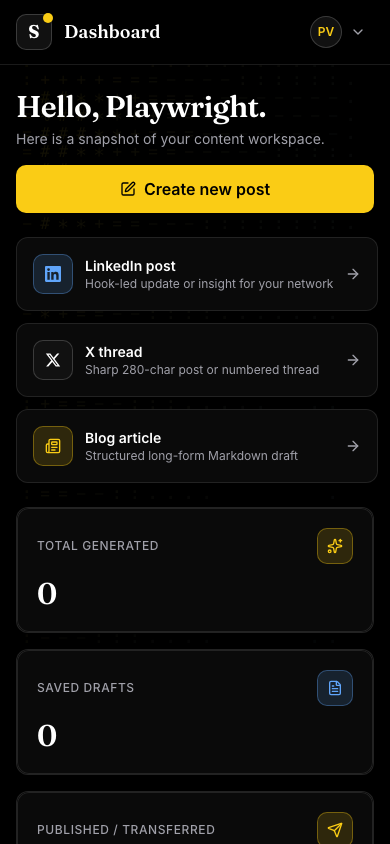
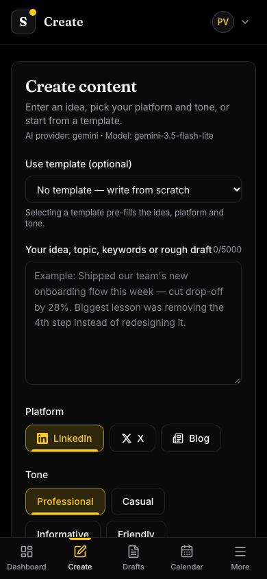
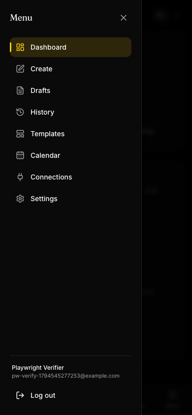

# Social Working Manager

**An AI-powered, single-pass multi-platform content workspace engineered with Next.js 14, Supabase PostgreSQL (RLS), and Server-Sent Event (SSE) LLM streaming.**  
Transform rough technical notes or founder updates into formatted **LinkedIn posts**, **280-character-compliant X (Twitter) threads**, and **Markdown blog articles** in one unified pipeline — saving an estimated **~90–94%** of manual cross-platform writing time.

<p align="center">
  
</p>

---

## Table of Contents

- [Theoretical Foundations & Performance Model](#theoretical-foundations--performance-model)
- [Time Reduction Graphs & Estimated Benchmarks](#time-reduction-graphs--estimated-benchmarks)
- [Defense-in-Depth: Hiding Sensitive Files & Blocking Direct Access](#defense-in-depth-hiding-sensitive-files--blocking-direct-access)
- [Visual Walkthrough](#visual-walkthrough)
- [Clean Repository & Folder Architecture](#clean-repository--folder-architecture)
- [Tech Stack](#tech-stack)
- [Quick Start & Deployment](#quick-start--deployment)

---

## Theoretical Foundations & Performance Model

### 1. Context-Switching Overhead: From $O(P \times T)$ to $O(1)$
In traditional creator workflows, producing content across $P$ platforms (**LinkedIn**, **X**, **Blog**) and $T$ editorial dimensions (**tone**, **character limits**, **structure**, **thread numbering**) incurs multiplicative friction:

$$\text{Total Time}_{\text{manual}} \approx \sum_{i=1}^{P} \left( t_{\text{ideate}} + t_{\text{draft},i} + t_{\text{format},i} + t_{\text{context-switch}} \right)$$

Moving a single idea manually across three formats forces repeated cognitive context switches (long-form hook crafting → strict 280-character segmentation → Markdown structuring). Social Working Manager consolidates platform grammars and tone constraints into parameterized system prompts (`src/lib/prompts.ts`) paired with server-side limit enforcement (`src/lib/text.ts`), collapsing multi-platform drafting into a single $O(1)$ input-to-output pipeline.

### 2. Perceived Latency Model: $\text{TTFT}$ vs. $\text{TTLB}$
Traditional blocking LLM endpoints delay feedback until **Time-To-Last-Byte ($\text{TTLB}$)** completes across generation, refinement, and database persistence:

$$L_{\text{blocking}} = L_{\text{LLM\_pass1}} + L_{\text{LLM\_refine}} + L_{\text{DB\_write}}$$

By streaming Google Gemini responses via REST SSE (`streamGenerateContent?alt=sse` in `src/lib/llm.ts` and `/api/generate/stream`), perceived waiting drops from full generation time to **Time-To-First-Token ($\text{TTFT}$)**:

$$L_{\text{perceived}} \approx \text{TTFT}_{\text{stream}} \ll \text{TTLB}$$

Post-generation X limit checks (`enforceXLimits`) and PostgreSQL persistence (`generated_contents`) execute at stream completion cleanly without blocking token delivery.

### 3. System Pipeline & Security Boundary Flow



---

## Time Reduction Graphs & Estimated Benchmarks

> *All time-reduction figures below represent **illustrative creator workflow estimates** comparing manual cross-platform writing, formatting, and scheduling against using Social Working Manager's streaming editor, templates, and automated thread enforcement.*

### Task Duration Comparison (Minutes per Task — Lower is Better)

```mermaid
xychart-beta
    title "Estimated Writing & Formatting Time: Manual vs. Social Working Manager (Minutes)"
    x-axis ["Single LinkedIn Post", "X Thread Split & Limits", "3-Platform Adapt", "Template + Refine Flow", "Avg Per-Post Prep"]
    y-axis "Minutes" 0 --> 55
    bar [25, 12, 50, 30, 45]
    bar [1.5, 0.1, 4, 2, 3.5]
    line [25, 12, 50, 30, 45]
    line [1.5, 0.1, 4, 2, 3.5]
```



### Weekly Time Allocation Breakdown (5 Cross-Platform Posts / Week)



### Detailed Efficiency Matrix & Visual Reduction Scale

| Workflow Stage | Manual Time | With App | Reduction | Visual Time Saved Scale |
| :--- | :---: | :---: | :---: | :--- |
| **Single LinkedIn Post** *(ideate + draft + hook)* | `25.0 min` | **`1.5 min`** | **-94%** | `███████████████████░` *(23.5 min saved)* |
| **X Thread Formatting** *(split + 280-char check + numbering)* | `12.0 min` | **`< 5 sec`** | **-99%** | `████████████████████` *(11.9 min saved)* |
| **3-Platform Adaptation** *(LinkedIn + X + Blog Markdown)* | `50.0 min` | **`4.0 min`** | **-92%** | `██████████████████░░` *(46.0 min saved)* |
| **Reusable Structure Prep** *(formatting + prompt reuse)* | `30.0 min` | **`2.0 min`** | **-93%** | `███████████████████░` *(28.0 min saved)* |
| **Weekly 5-Post Sprint** *(full batch + calendar plan)* | `330 min` *(5.5 hrs)* | **`25 min`** | **-92%** | `██████████████████░░` *(~5 hrs/week saved)* |

---

## Defense-in-Depth: Hiding Sensitive Files & Blocking Direct Access

This repository enforces **5 isolation layers** so secrets, credentials, internal tooling, and database tokens cannot be accessed directly via GitHub, the browser, or API responses:

1. **Repository & Secret Exclusion (`.gitignore`):**
   - Strictly excludes `.env`, `.env.*` *(except safe placeholder `.env.example`)*, private keys (`*.key`, `*.pem`, `*.p12`, `*.pfx`), local archives (`*.zip`, `*.tar.gz`), logs (`*.log`), IDE configs (`.vscode/`, `.idea/`), and build artifacts (`.next/`, `node_modules/`).
2. **No Raw File Exposure Over HTTP:**
   - All application modules reside cleanly inside `src/`. Next.js App Router only compiles routes inside `src/app/` and exposes **zero** source files, `.env*` files, SQL scripts (`supabase/`), or maintenance scripts (`scripts/`) over HTTP.
3. **Crawler & Route Restrictions (`src/app/robots.ts` + HTTP Security Headers):**
   - `src/app/robots.ts` explicitly disallows search crawlers on `/api/`, `/auth/`, and all protected workspace paths (`/dashboard`, `/create`, `/drafts`, `/history`, `/templates`, `/calendar`, `/connections`, `/settings`).
   - `next.config.mjs` applies `X-Frame-Options: DENY`, `X-Content-Type-Options: nosniff`, `Strict-Transport-Security`, `Referrer-Policy`, and `Permissions-Policy` to every response.
4. **Compile-Time Server-Only Isolation (`"server-only"`):**
   - Sensitive server modules (`src/lib/crypto.ts`, `src/lib/connections.ts`, `src/lib/llm.ts`, `src/lib/oauth.ts`, `src/lib/supabase/server.ts`) import `"server-only"`, making accidental bundling into client JavaScript impossible at build time.
5. **Edge Auth + PostgreSQL RLS + Column-Level Token Protection:**
   - `src/middleware.ts` intercepts protected paths at the edge and redirects unauthenticated users to `/login`.
   - OAuth access/refresh tokens are encrypted at rest with **AES-256-GCM** (`TOKEN_ENCRYPTION_KEY`) and protected via `REVOKE SELECT` column privileges in `supabase/migrations/002_protect_tokens.sql`.

---

## Visual Walkthrough

### 1. Landing Page (`/` — High-Contrast Black + Yellow + Blue Theme)
Combines a capped-FPS HTML5 Canvas ASCII gradient backdrop (`AsciiGradientBg`), scroll progress bar, 3D cylinder text reveal (`CylinderReveal`), and value highlight section (`BlurValueParagraph`). Supports `prefers-reduced-motion` and instant plain fallback (`NEXT_PUBLIC_BASIC_UI=true`).


### 2. Command Center Dashboard (`/dashboard`)
Displays quick-start platform launch cards (`/create?platform=LINKEDIN|X_TWITTER|BLOG`), real-time workspace metrics, recent draft shortcuts, and a Recharts **Posts per Platform** visualization.


### 3. Live Streaming Creation Workspace (`/create`)
Streams AI drafts in real time via SSE, lets users pick `{placeholder}` templates and tones (`Professional`, `Casual`, `Informative`, `Friendly`), run an on-demand **Refine flow** pass (`/api/refine`), toggle Markdown preview, enforce X 280-char limits automatically, save drafts, or publish immediately.


### 4. Drafts Library & Version Comparison (`/drafts`, `/history`)
Searchable/filterable draft management, dedicated draft editing (`/drafts/[id]`), and raw vs. refined comparison inside generation history.


### 5. Split-Pane Authentication (`/login`, `/register`)
Asymmetric login/signup views integrated with Supabase Auth (`react-hook-form` + `zod` schema validation).


### 6. Responsive Mobile Workspace (`390px`)
Responsive 5-slot mobile navigation bar with a left-sliding full menu drawer exposing all 8 workspace sections.

| Mobile Landing | Mobile Dashboard | Mobile Create | Mobile Nav Drawer |
| :---: | :---: | :---: | :---: |
|  |  |  |  |

---

## Clean Repository & Folder Architecture

Application source code is encapsulated inside `src/`, keeping root configuration, SQL migrations, developer scripts, and documentation neatly separated:

```text
├── src/
│   ├── app/
│   │   ├── (marketing)/       # Public landing page (/)
│   │   ├── (auth)/            # Split-screen /login & /register pages
│   │   ├── (app)/             # Protected routes: dashboard, create, drafts, history, templates, calendar, connections, settings
│   │   ├── api/               # REST & SSE handlers (/generate/stream, /refine, /publish, /connections/*, CRUD)
│   │   ├── globals.css        # CSS color tokens (--rgb-*), selection, typography, reduced-motion rules
│   │   ├── layout.tsx         # Fonts (Fraunces + Inter), Toaster, NavProgress, metadata
│   │   └── robots.ts          # Crawler disallow rules for /api/, /auth/, and workspace routes
│   ├── components/
│   │   ├── auth/              # Login & Register client forms
│   │   ├── calendar/          # Monthly planning calendar grid & mobile list view
│   │   ├── connections/       # OAuth connection cards & Publish / One-Click Transfer modal
│   │   ├── create/            # Streaming editor, platform/tone chips, Markdown preview
│   │   ├── dashboard/         # Stat cards & Recharts platform breakdown chart
│   │   ├── drafts/            # Draft list, filters & standalone draft editor
│   │   ├── history/           # Raw vs. refined diff viewer
│   │   ├── landing/           # ASCII gradient canvas, CylinderReveal, BlurValueParagraph, ScrollProgress
│   │   ├── layout/            # AppShell sidebar, mobile drawer, NavProgress, Logo
│   │   ├── reactbits/         # Dark-tokenized interactive cards & accents
│   │   └── ui/                # Shared accessible Radix + Tailwind UI primitives
│   ├── lib/
│   │   ├── platforms/         # Platform adapters (LinkedIn, X OAuth/thread publisher, Blog Markdown)
│   │   ├── supabase/          # SSR, browser & middleware Supabase clients
│   │   ├── crypto.ts          # Server-only AES-256-GCM encryption for OAuth tokens
│   │   ├── llm.ts             # Pluggable Gemini SSE / OpenAI / Anthropic engine
│   │   ├── prompts.ts         # Structured platform & tone prompt builders
│   │   └── text.ts            # X 280-char boundary enforcement & thread splitter
│   └── middleware.ts          # Edge auth session refresh & route protection
├── supabase/
│   ├── migrations/            # Incremental SQL migrations (schema, token column locks, refresh tokens)
│   └── setup_all.sql          # Single-file idempotent database bootstrap script
├── scripts/                   # Contrast checker, LLM benchmarks, X mock test suite, RLS verifier
├── docs/
│   ├── guides/                # X OAuth 2.0 setup guide (X_SETUP.md)
│   ├── reports/               # Project report, FR traceability matrix, demo walkthrough
│   └── screenshots/           # Desktop (1280px) & mobile (390px) UI screenshots
├── .env.example               # Safe template of required environment variables (no secrets)
├── .gitignore                 # Excludes .env*, private keys, archives, logs, build caches
└── next.config.mjs            # Security headers (HSTS, X-Frame-Options, nosniff, Referrer-Policy)
```

---

## Tech Stack

| Layer | Technologies |
| :--- | :--- |
| **Core Framework** | Next.js `14.2` (App Router), React `18.3`, TypeScript `5.9` (`strict: true`) |
| **Styling & Design System** | Tailwind CSS `3.4`, `tailwindcss-animate`, CSS custom properties with `<alpha-value>` RGB triplets, WCAG AA checked palette |
| **UI & Data Visualization** | Radix UI (`Dialog`, `AlertDialog`, `DropdownMenu`, `Select`, `Tabs`), `lucide-react`, `sonner`, `recharts`, `react-markdown` |
| **Canvas & Motion** | Custom HTML5 2D Canvas ASCII field (`20 FPS` cap, DPR `<= 1.5`), `IntersectionObserver` scroll reveals, `motion` |
| **Database & Auth** | Supabase (`@supabase/ssr`, `@supabase/supabase-js`) — PostgreSQL, Email Auth, Row-Level Security (RLS), Signup Triggers |
| **AI Providers** | Google Gemini REST SSE (`streamGenerateContent?alt=sse`), OpenAI Chat Completions, Anthropic Messages API |
| **Publishing & Crypto** | LinkedIn OAuth 2.0, X OAuth 2.0 PKCE + refresh rotation, AES-256-GCM encryption (`TOKEN_ENCRYPTION_KEY`), One-Click Transfer |
| **Validation & QA** | `react-hook-form`, `zod`, Playwright (`1.65`), `scripts/check-contrast.mjs`, `scripts/test-x.mjs`, `scripts/test-rls.mjs` |

---

## Quick Start & Deployment

### 1. Prerequisites
- **Node.js** `18.18+` (or `20+` / `22+`) and **npm**
- A free **[Supabase](https://supabase.com)** project
- An API key for **Google Gemini** *(default)*, **OpenAI**, or **Anthropic**

### 2. Supabase Database Setup
1. Create a project at [database.new](https://database.new).
2. Open **SQL Editor → New query**, paste [`supabase/setup_all.sql`](./supabase/setup_all.sql), and run it.
3. In **Authentication → Providers → Email**, disable **Confirm email** for local testing.
4. Add `http://localhost:3000/auth/callback` under **Authentication → URL Configuration → Redirect URLs**.

### 3. Local Environment (`.env.local` stays strictly private)
Copy `.env.example` to `.env.local` and generate an encryption key:

```bash
cp .env.example .env.local
openssl rand -base64 32   # paste into TOKEN_ENCRYPTION_KEY
```

Minimum required keys in `.env.local`:

```env
NEXT_PUBLIC_SUPABASE_URL=your_supabase_url
NEXT_PUBLIC_SUPABASE_ANON_KEY=your_anon_key
SUPABASE_SERVICE_ROLE_KEY=your_service_role_key

LLM_PROVIDER=gemini
GEMINI_API_KEY=your_gemini_api_key

TOKEN_ENCRYPTION_KEY=your_32byte_base64_key
NEXT_PUBLIC_APP_URL=http://localhost:3000
NEXT_PUBLIC_BASIC_UI=false
```

> Optional OAuth setup instructions for direct X (Twitter) PKCE posting live in [docs/guides/X_SETUP.md](./docs/guides/X_SETUP.md). When OAuth keys are omitted, **Publish / Transfer** automatically switches to the zero-credential transfer flow.

### 4. Run & Verify

```bash
npm install
npm run check:setup      # Verify env vars, Supabase tables/triggers & LLM health
npm run check:contrast   # Verify all 19 WCAG AA color pairs (>= 4.5:1)
npm run typecheck        # Run strict TypeScript checking
npm run dev              # Launch at http://localhost:3000
```

| Script | Purpose |
| :--- | :--- |
| `npm run dev` / `npm run build` | Development server & production build |
| `npm run typecheck` / `npm run lint` | TypeScript & ESLint validation |
| `npm run check:contrast` | Automated WCAG AA palette verification |
| `npm run test:x` | X thread splitting, token rotation & error mapping test suite |
| `npm run test:rls` | Cross-tenant Supabase RLS isolation verification |
| `npm run bench:llm` | LLM latency benchmark script |

### 5. Deploy to Vercel
Import the repository into [Vercel](https://vercel.com/new), configure all variables from `.env.example` in **Project Settings → Environment Variables** (`NEXT_PUBLIC_APP_URL=https://your-app.vercel.app`), add `https://your-app.vercel.app/auth/callback` to Supabase Redirect URLs, and deploy.
